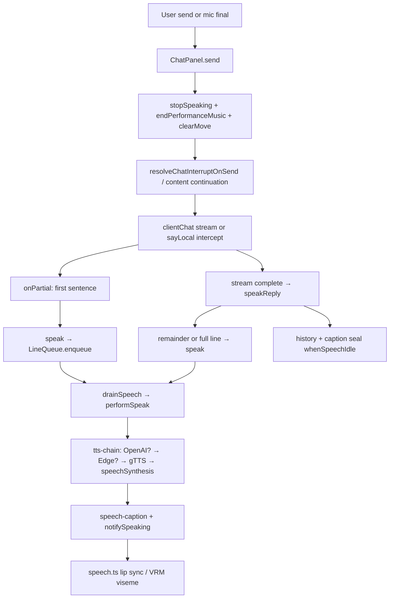
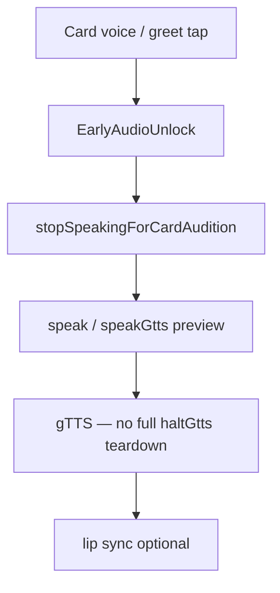

# Voice chat lifecycle (overlap + interrupt + new topic)

Planning doc for Pixel and agents coordinating **voice overlapping fixes** with **interrupt → new topic** when the prior thread is unfinished. Aligns with agent run **Interrupt talk + new topic** (`bcb37eb7`; transcript not readable from this run) and phone rows in [`PHONE_SMOKE.md`](./PHONE_SMOKE.md) (no double-speak, no history-resume ask).

**Code (P0):** `apps/web/lib/chat-interrupt.ts` + `ChatPanel.send` on branch `cursor/chat-interrupt-new-topic-0340-0eac`.

---

## 1. Current flow (chat vs card)

### Chat path

| Stage | File |
|--------|------|
| Queue / epoch | `apps/web/lib/speech-queue.ts` |
| Tiers + halt | `apps/web/lib/voice.ts` (`speak`, `stopSpeaking`, `drainSpeech`) |
| Turn wiring | `apps/web/components/ChatPanel.tsx` (`send`, `speakReply`, `onPartial`) |
| Captions / lip | `speech-caption.ts`, `speech.ts` |

### Card path

Keep **chat** `stopSpeaking` and **card** `stopSpeakingForCardAudition` separate (`card-greet-gesture-clip.test.ts`).

---

## 2. Failure modes

| Symptom | Likely cause | Where |
|--------|----------------|--------|
| Double speak | Stream lead + full `speakReply`; diverged lead | `onPartial`, `speechLeadDiverged` |
| Ghost audio | Stale tier; no LLM abort on new send | `voice.ts`, `client-chat.ts` |
| Overlap | Queue not interrupted; BGM + TTS | `LineQueue`, `music.ts` |
| Interrupt ignored | `send` while `busyRef`; mic barge-in once per burst | `ChatPanel` |
| New topic, old context | History cap + continuation session | `client-chat.ts`, `content-continuation.ts` |
| History-resume spoken | Model asks to continue | `spoken-line-sanity.ts` |
| Card silent after chat | Full `stopSpeaking` on card tap | select greet path |

---

## 3. Target behavior

1. **Single active utterance** — one audible line; `stopSpeaking` bumps queue epoch and stops all tiers.
2. **Interrupt = halt all tiers** — send, mic barge-in, 停 / stop, new-topic phrase (speech already cut in `send`).
3. **New topic** — clear `contentContinuation` session (P0); P1: abort stale `clientChat`; P2: optional history/caption policy.
4. **Stop** — `contentStopAck` local line (unchanged).
5. **Card isolation** — no regression vs #519 card voice chain.

---

## 4. Phrase / intent (yue / en / zh / ja)

Module: `apps/web/lib/chat-interrupt.ts` (stop phrases reuse `userSaysStopContent` in `content-continuation.ts`).

| Intent | Examples |
|--------|-----------|
| Stop | 停, 夠喇, stop talking, enough, やめて, 轉話題 (stop thread) |
| New topic | 新話題, 转话题, 講第二樣, new topic, let's talk about …, change subject |
| Continue | 然後呢, go on — `CONTENT_NUDGE_RE` |

---

## 5. Phases + file map

| Phase | Work | Files |
|-------|------|--------|
| **P0** ✓ | New-topic regex; clear continuation on send | `chat-interrupt.ts`, `ChatPanel.tsx`, `chat-interrupt.test.ts` |
| **P1** | `clientChat` abort; busy-send policy; tier epoch audit | `client-chat.ts`, `voice.ts`, `ChatPanel.tsx` |
| **P2** | LLM topic pivot block; story session; caption on interrupt | `llm.ts`, `speech-caption.ts` |

---

## 6. Test matrix

**Vitest:** `chat-interrupt`, `speech-queue`, `no-double-speak`, `content-continuation` (+ `voice-http-tier`, `mic-auto-on-enter` for P1).

**Phone** ([`PHONE_SMOKE.md`](./PHONE_SMOKE.md)): no double-speak; mic barge-in; no resume ask; card greet after mic.

---

## 7. Merge order vs #519

1. **#519 card voice** (merged **r228** on `main`) — baseline card audition.
2. **This branch** — chat send / continuation only; do not merge card halt paths.
3. **Stream-lead overlap fixes** — same `speakReply` touchpoints.
4. **P1 abort** — after P0 lands.

Wait for green CI before merge.

---

## Related

[`TTS_PIPELINE.md`](./TTS_PIPELINE.md) · [`CHAT_ENTRY_FLOW.md`](./CHAT_ENTRY_FLOW.md) · [`PROJECT_STATUS.md`](./PROJECT_STATUS.md)